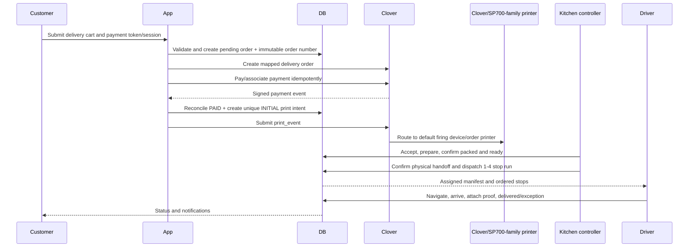
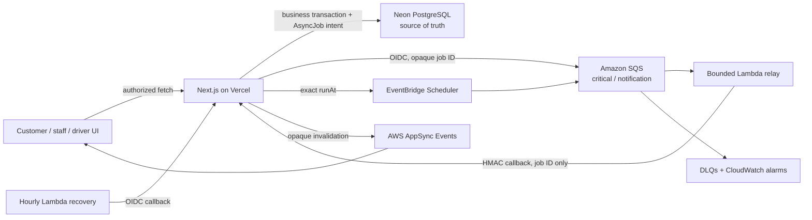

# Target Launch Architecture

This is the target architecture for the delivery launch. Proposed models and interfaces do not exist merely because they appear here; `IMPLEMENTATION_STATUS.md` records actual state.

## System boundaries

Buffet Pin Direct owns customer ordering, server-authoritative pricing, delivery eligibility, operational identity, fulfillment truth, dispatch, customer status, audit history, and reconciliation evidence.

Clover owns payment-provider facts and is the preferred transport for a printable Clover Order to the merchant's default firing device/order printer. The reported Star SP700-family printer is a physical endpoint behind Clover, not a printer that the Vercel application should attempt to reach directly over restaurant LAN.

Google (or a replaceable routing provider) supplies geocoding and travel-time/route calculations. Twilio (or a replaceable notification provider) supplies SMS delivery. Supabase supplies identity for privileged users where retained.

## End-to-end flow



## Sources of truth

| Concern | Authority | Local responsibility |
|---|---|---|
| Menu/product availability | Open decision: Clover or app | Cache/mapping, publish state, checkout validation, immutable snapshots |
| Price charged | Server-calculated cart, reconciled with Clover request | Store item/tax/fee/tip/total snapshots |
| Provider payment | Clover signed response/webhook | Non-downgrading local projection and provider evidence |
| Kitchen print intent/state | Local `PrintJob`, reconciled with Clover print event | Unique initial intent, explicit unknown/failure/reprint |
| Production/packing | Local kitchen-controller actions | Valid transitions, actor, timestamp, exception visibility |
| Dispatch/run | Local controller/driver actions | Capacity, zone, route, physical handoff, manifest, delivery evidence |
| Customer view | Local projections | Minimal public data and polling/notification consistency |

## Identity model

- `Order.id`: internal immutable database identifier.
- `Order.trackingToken`: high-entropy public access credential; never printed or spoken.
- `Order.orderNumber`: short immutable human identifier visible to customer, Clover order/title/note, kitchen ticket, bag, staff, driver, refunds, and reports.
- `ExternalOrder.providerOrderId`: Clover's internal order identifier.
- `Payment.providerPaymentId`: Clover payment/charge identifier.
- `PrintJob.providerPrintEventId`: Clover print-event identifier when known.

Do not use a predictable order number as the only authorization for the public order endpoint.

## State separation

Payment answers what happened to money. Printing answers whether the kitchen ticket intent was submitted/observed. Production answers where the food is. Dispatch answers where the delivery work is. These dimensions must not be collapsed into one enum.

Proposed state families:

- Payment: `PENDING`, `PAID`, `FAILED`, `PARTIALLY_REFUNDED`, `REFUNDED`.
- Refund: `NOT_REQUIRED`, `REQUIRED`, `PENDING`, `SUCCEEDED`, `PARTIAL`, `FAILED`.
- Print: `PENDING`, `SUBMITTED`, `PRINTING`, `PRINTED`, `FAILED`, `UNKNOWN`.
- Production: `AWAITING_ACCEPTANCE`, `ACCEPTED`, `PREPARING`, `PACKING`, `PACKED`, `AT_DISPATCH_DESK`, `REJECTED`, `CANCELLED`.
- Run: `DRAFT`, `PLANNED`, `ASSIGNED`, `READY`, `PICKED_UP`, `EN_ROUTE`, `COMPLETED`, `CANCELLED`, `EXCEPTION`.
- Stop: `PLANNED`, `PICKED_UP`, `EN_ROUTE`, `DELIVERED`, `FAILED`, `CANCELLED`.

Exact names are Milestone 1 implementation decisions; semantic separation is the invariant.

## Cross-system reliability

External side effects cannot be made atomic with Postgres. Use durable intent records:

1. A database transaction reconciles the authoritative local state and inserts a unique pending job/intent.
2. A worker attempts the external call after commit.
3. Provider identifiers and sanitized evidence are stored.
4. A reconciliation process revisits pending/unknown work.
5. Alerts expose jobs beyond their service threshold.
6. Operators can resolve or explicitly reattempt ambiguous work.

Uniqueness should enforce one initial print intent per order. Reprint jobs are separate, actor-attributed, and labelled. An external timeout after request submission is `UNKNOWN`, not automatically `FAILED`, because a blind retry may duplicate physical output.

This follows the general principle of retry-safe/idempotent APIs described in [Prisma's transaction guidance](https://www.prisma.io/docs/orm/prisma-client/queries/transactions).

## Provider interfaces

Keep interfaces narrow and business-oriented rather than mirroring entire SDKs.

```ts
interface PaymentGateway {
  createPayment(input: PaymentRequest): Promise<PaymentResult>;
  reconcile(event: VerifiedPaymentEvent): Promise<PaymentReconciliation>;
  refund(input: RefundRequest): Promise<RefundResult>;
}

interface CloverOrderGateway {
  createOrder(input: ProviderOrderRequest): Promise<ProviderOrderResult>;
  getOrder(providerOrderId: string): Promise<ProviderOrderResult>;
}

interface OrderPrinter {
  submit(input: PrintRequest): Promise<PrintSubmission>;
  getStatus(providerPrintEventId: string): Promise<PrintObservation>;
}

interface MenuProvider {
  readCatalog(): Promise<ProviderCatalog>;
  publishAvailability?(change: AvailabilityChange): Promise<void>;
}

interface RoutingProvider {
  computeMatrix(input: RouteMatrixRequest): Promise<RouteMatrix>;
  orderStops(input: StopOrderingRequest): Promise<OrderedRoute>;
}

interface NotificationProvider {
  send(input: NotificationRequest): Promise<NotificationResult>;
}

interface GeocodingProvider {
  geocode(input: AddressInput): Promise<GeocodedAddress>;
}
```

Each real provider must have a deterministic fake capable of success, terminal failure, transient failure, timeout/unknown outcome, duplicate callback, and recovery where applicable. Test/failure-injection modes must be impossible to enable in production.

## Proposed persistence additions

Milestone 1 should refine these names and migrations:

- Operational `orderNumber` and separate `trackingToken`.
- Provider order record or explicit order-level Clover reference.
- Delivery zone ID/name snapshot and promise/deadline timestamps.
- `PrintJob` with purpose, state, event ID, attempts, observations, errors, timestamps, and actor.
- Production status/timestamps independent of dispatch.
- Staff role/capability and access-audit representation.
- `DeliveryRun` with zone, driver, capacity, route metrics, departure, state, and override metadata.
- `DeliveryStop` with order, stable sequence, ETA, result, and evidence.
- Catalog/provider mapping and sync-state records.
- Reconciliation run/result/exception records if reporting queries alone are insufficient.

## Catalog boundary

The delivery catalog is distinct from the full restaurant/pickup menu. One system must be authoritative; dual manual editing is prohibited. The recommended direction is a Clover-owned operational delivery catalog imported/projected to the app because physical printing is most reliable with recognized inventory items and linked modifiers, but this remains an explicit manager decision.

Orders always retain name, description, price, modifier, tax, and fee snapshots. Later catalog changes never rewrite historical orders.

Clover documents the need for valid inventory items and associated modifiers for reliable Atomic Order printing in its [Orders FAQ](https://docs.clover.com/dev/docs/orders-faqs).

## Printing boundary

Preferred flow:

1. Create a valid Clover order with a delivery order type and mapped catalog data.
2. Associate/complete the payment through the documented Clover Ecommerce path.
3. Reconcile paid state.
4. Create the unique initial print intent.
5. Submit `POST /v3/merchants/{mId}/print_event` with the Clover order ID.
6. Record/poll/reconcile the event and expose failure/unknown state.

Clover states that `print_event` routes to the default firing device's order printer or onboard printer and requires Read/Write Orders permissions. Clover also documents offline queuing and merchant failure email behavior, but Buffet Pin must maintain its own paid-but-unprinted alert and recovery path. See [Print Orders](https://docs.clover.com/dev/docs/printing-orders-rest-api) and [Devices and Printers FAQ](https://docs.clover.com/dev/docs/faqs).

Fallback decision order: Clover Print API; Clover device app/Order Connector; Star cloud capability if the exact variant supports it; local print bridge only as a last resort. Never let fallback paths bypass payment or audit invariants.

## Production and packing

The paper ticket remains a physical artifact, but the database records authoritative handoffs:

- The kitchen controller acknowledges/rejects and starts production.
- The same controller verifies items/modifiers/instructions and confirms that the order is packed and physically ready.
- Packing remains an internal/audited fact but is not a separate normal visible lane; the controller experience presents `Preparing` followed by `Ready for delivery`.
- The controller confirms the physical bag-to-driver handoff before dispatch transfers ownership.
- Cancellation/refund warnings remove or block stale physical work.

Every action requires actor, time, previous state, next state, and optional reason. The UI should optimize for large order numbers, few taps, search/recovery, and obvious exceptions.

## Delivery zones and runs

The order snapshots the selected zone at checkout. A `DeliveryRun` contains one to four `DeliveryStop` records and normally one zone. The application recommends the eligible driver, batch, stop order, safe wait, and departure timing; the kitchen controller confirms the physical handoff and dispatches. The routing provider never owns the decision.

Candidate inputs:

- Zone and driver eligibility.
- Packed/dispatch-desk readiness or a separately configured near-ready policy.
- Order age and dispatch deadline.
- Promised delivery end.
- Traffic-aware travel time/distance matrix.
- Current driver availability and run capacity.

Hard constraints precede optimization. The objective is lexicographic: avoid late delivery, avoid food waiting, then minimize driving and increase utilization. Release occurs at capacity, oldest-wait threshold, deadline risk, low-demand decision, or manual override.

Google's [Compute Route Matrix](https://developers.google.com/maps/documentation/routes/compute_route_matrix) can provide distances/durations between origins and destinations; provider contracts prevent vendor lock-in and allow deterministic tests.

## Authorization boundary

- Manager: catalog, arbitrary/partial refunds where enabled, staff, settings, reconciliation, and exceptional overrides.
- Kitchen controller: incoming-order decision, print recovery, prepare/ready confirmation, safe run approval, bag verification, and physical dispatch through a least-privilege capability bundle.
- Reporting: read-only operational/financial reports if needed.
- Driver: assigned runs/current stop, navigation handoff, arrival, proof, delivery, and exception only.

Server modules and route handlers enforce policy. UI capability is a usability projection, not security.

## Customer and finance flows

The public endpoint uses the private tracking token, returns only customer-safe projections, and never exposes internal notes or provider secrets. Notifications are intent-recorded and idempotent.

Paid rejection and cancellation invoke the same refund coordinator. Reconciliation compares local order/payment/refund totals and identifiers to Clover evidence, surfaces unmatched/ambiguous rows, and records manager resolution. Receipt content remains subject to Québec accounting/legal review.

## Failure model

| Failure | Required representation | Recovery |
|---|---|---|
| Payment timeout | Pending/unknown payment evidence; never cook | Webhook/provider reconciliation |
| Duplicate callback | Existing idempotent result | Acknowledge without new side effect |
| Paid but print submission failed | Paid order + failed print job + alert | Retry only when outcome is known; manual fallback |
| Print timeout after submission | `UNKNOWN` | Query Clover/operator confirmation; explicit reprint |
| Printer offline | Pending/failed/unknown observation + staff alert | Clover queue/recovery, browser/paper fallback |
| Catalog mismatch | Checkout or publish blocked | Manager repairs mapping/sync |
| Route provider unavailable | Manual route mode | Dispatcher orders stops manually |
| Driver unavailable | Run exception/reassignment | Dispatcher assigns another eligible driver |
| Paid cancellation | Refund required/pending | Refund coordinator and exception queue |
| Notification failure | Failed notification intent | Retry/escalate without changing order truth |
| App outage | External health alert | Kill switch/provider controls and paper runbook |

## Observability

Metrics and alerts should cover payment-to-print, print failure/unknown age, payment-to-acceptance, prep, packing, desk wait, batch size, run departure, on-time delivery, failed stops, refunds, notification failures, and reconciliation differences. These timestamps are also the future input to data-driven forecasting; AI is not a launch dependency.

## Deployment and rollback

Use feature flags for Clover Orders, auto-print submission, new production workflow, delivery runs, and route suggestions. Additive migrations deploy before code consumes them. Production ordering remains off through migration/smoke checks. Rollback must preserve paid orders and durable pending intents even when a UI feature is disabled.

## Event-driven infrastructure boundary

The database-compute problem is structural: a small dataset can still consume substantial compute when every browser repeatedly reloads projections and when the database is continuously asked “what is due?” or “what failed?” PostgreSQL is optimized to transact and query business truth, not to act as a fleet-wide clock, delivery queue, retry timer, and change-notification bus.

The deployed M11 boundary is:



- Neon is authoritative for orders, reservations, provider intents, audit history, and `AsyncJob` state.
- A transaction records the durable job intent. Queue delivery is recoverable transport, never the business record.
- Critical and notification work have separate SQS concurrency/retry/DLQ lanes. Workers acquire token-fenced leases, so a late worker cannot overwrite its successor.
- Reservation reminders use one-time schedules and cancel superseded job identities. Hourly recovery repairs missed dispatch or expired leases without returning to minute-scale discovery scans.
- AppSync publishes channel-scoped invalidations only. It never publishes customer details, order contents, addresses, provider facts, or payment data; the browser refetches an authorized API projection.
- Vercel assumes the AWS runtime role with OIDC. AWS invokes only signed internal routes and does not store Clover, Twilio, database, or Supabase credentials.
- `ASYNC_JOBS_MODE=inline|shadow|aws` and `NEXT_PUBLIC_REALTIME_MODE=poll|appsync` provide reversible transport switches. Disabling either transport does not delete durable intents or alter business truth.

The stack intentionally avoids RDS, DynamoDB, ElastiCache, ECS, Step Functions, DMS, and a NAT gateway. Those services would add cost and a second persistence/runtime surface without addressing the root cause better than queueing, exact deadlines, and invalidation delivery.

## External evidence gates

Architecture cannot prove compatibility of the exact SP700-family submodel/interface, merchant permissions, physical modifier layout, live payments/refunds, routes, staff usability, receipt compliance, or operational timing. `KNOWN_EXTERNAL_GAPS.md` owns those gates; `MANUAL_TEST_PLAN.md` closes them with evidence.
