# Buffet Pin Direct Launch Master Plan

Status: repository implementation is code-complete through M11 and the confirmed ordering-experience rework; external/manual verification package open, 2026-08-13. This document governs the path to a controlled delivery launch and does not assert that external systems or physical operations have been verified.

## Executive summary

Buffet Pin Direct now has the repository-verifiable delivery operating layers defined by this plan: server-authoritative catalog/pricing, mapped Clover order/payment/print contracts, immutable operational numbering and private tracking, independent operational states, production/packing/dispatch/run workflows, staff capabilities, deterministic routing fallback, durable refunds/notifications/reconciliation, monitoring and recovery UIs.

`ORDERING_EXPERIENCE_VISION.md` defines the customer experience, one Kitchen Controller console, and one focused driver application. The repository implementation now follows that model: paid-order deadline and alarm, acceptance/refusal, preparation, internal packing evidence behind one ready action, proactive dispatch recommendations, physical-handoff dispatch, ordered driver stops, private delivery proof, customer status, and independent SMS/email intents. Representative-device, provider, privacy, and physical workflow evidence remains manual.

It is not launch-verified. Clover merchant configuration, the exact configured SP700-family printer, staff/device workflow, real routes and addresses, Twilio delivery, Québec receipt requirements, hosting/backup/support controls, controlled production payments/refunds, and go/no-go authority remain external gates.

The launch strategy is sequential: make the system testable, prove durable order identity and state, integrate Clover catalog/order/printing behind fakes, model the physical handoffs, add delivery runs and routing, harden finance and failure recovery, then conduct sandbox, on-site, staff, and limited-production gates.

## Source hierarchy

1. Explicit user decisions recorded in `DECISIONS.md`.
2. `ORDERING_EXPERIENCE_VISION.md` for the day-to-day ordering product, actors, ownership handoff, and visible lifecycle.
3. This master plan and the other files in `docs/launch/` for launch safety, implementation sequencing, acceptance, and external gates.
4. Current repository behavior.
5. `docs/buffet-pin-direct-master-plan.md` and older planning context.

Conflicts are recorded rather than silently resolved.

## Historical pre-M0 capabilities

- Next.js App Router application with Prisma/Postgres and Supabase admin authentication.
- Delivery-only customer UI currently hard-coded to `DELIVERY`.
- Server-side item, modifier, tax, tip, delivery fee, availability, and delivery-zone validation.
- Local order/item/modifier snapshots and unique random public code.
- Clover Hosted Checkout fallback and embedded Ecommerce charge path.
- Unique payment idempotency key and provider payment ID constraints.
- Signed Clover webhook ingestion with unique provider event IDs and non-downgrading paid-state reconciliation.
- Separate payment, refund, and combined fulfillment status fields.
- Automatic Clover void/refund attempt when an admin rejects a paid order, with customer/admin notifications.
- Admin order queue with accept, reject, preparation, ready, driver assignment, browser print, event history, and polling.
- Delivery-zone models using circle/radius matching and fee/minimum rules.
- Limited drivers with revocable access links and one driver assignment per order.
- Customer status page and Twilio SMS notifications.
- Emergency online-order settings and test-bypass controls.

## Historical pre-M0 deficiencies (resolved in repository unless explicitly external)

- No Clover Platform Order creation or `print_event` implementation; browser printing is manual and not a kitchen delivery guarantee.
- The Star SP700 family is reported, but exact submodel/suffix/interface, Clover device, default firing device, and physical behavior are unverified.
- The human-facing public code doubles as the tracking credential; there is no separate short operational order number.
- No persistent print job, print status, unknown-outcome handling, failure alert, or audited reprint model.
- No Clover inventory IDs on local items/modifiers and no catalog synchronization or mismatch report.
- The selected delivery zone is calculated but not snapshotted onto `Order`.
- `OrderFulfillmentStatus` combines restaurant production and driver delivery; there are no explicit packing or dispatch-desk states.
- Any allow-listed admin has the same effective privileges; no manager/operator/dispatcher/reporting roles.
- One driver is assigned directly to one order; there is no delivery run, stop ordering, capacity, or batch departure decision.
- No routing provider or travel-time matrix.
- Generic paid cancellation does not share the rejection refund workflow.
- No formal receipt flow or daily app-to-Clover reconciliation report.
- No automated test framework or CI-safe lint command.
- No paid-but-unprinted, stuck-order, late-order, refund, or reconciliation monitoring surface.
- No rehearsed operational fallback or defined support ownership.

## Historical pre-M0 baseline verification

On 2026-07-22:

- `npx tsc --noEmit` passed.
- `npm run build` compiled successfully, then failed during page-data collection because the local `.env` is invalid for production: `DRIVER_SESSION_SECRET` is absent and sandbox-only `CLOVER_TEST_CHARGE_CURRENCY` is set. Production validation must remain strict; Milestone 0 must provide a safe build environment.
- `npm run lint` invoked deprecated interactive `next lint`, so lint is not automation-ready.
- No unit, integration, contract, or browser test runner is configured.

## Target launch scope

- Delivery only; no customer pickup launch.
- Dedicated delivery catalog and modifiers.
- ASAP orders only.
- Online Clover payment with server-side reconciliation.
- One default Clover order printer: Star Micronics SP700 family, exact submodel/interface pending confirmation.
- One kitchen controller owns each paid restaurant order from the incoming-order decision through preparation, packing confirmation, driver/batch coordination, and physical-handoff dispatch.
- Packing remains a required physical/audited fact but is not a separate normal visible lane in the controller experience.
- The application recommends one-zone delivery runs of one to four orders, eligible drivers, stop order, safe wait, and departure timing; the controller confirms the physical handoff and dispatches.
- A driver receives an ordered manifest after dispatch, focuses one current stop, uses maps directions, records arrival and required photo proof, and completes delivery or a specific exception.
- Customer SMS/status updates, refunds, receipts, and support/reconciliation tools.
- Controlled pilot with limited menu, radius, hours, and order concurrency.

## Explicitly deferred

- Customer pickup and the full restaurant/pickup catalog.
- Scheduled orders.
- Station-specific printer routing or multiple printers.
- Fully autonomous dispatch.
- AI demand, prep-time, or batch-release prediction.
- Live GPS customer tracking.
- Advanced fleet scheduling or cross-zone optimization.

The architecture must not preclude these, but launch work must not depend on them.

## First-principles requirements

1. No paid order may disappear silently between payment, printing, preparation, packing, dispatch, and delivery.
2. No unpaid order may be released to production.
3. A human can identify the same order at every physical and digital handoff.
4. A retried request must not create a second charge, initial ticket, refund, or delivery assignment.
5. Each state describes a real fact; payment, print, restaurant production, and dispatch are separate dimensions.
6. External ambiguity is represented explicitly and reconciled instead of guessed.
7. Humans can override recommendations, and overrides are audited.
8. A batch is valuable only if it does not violate freshness or promised delivery time.
9. Every failure has an owner, visible alert, recovery action, and fallback.
10. Launch claims require evidence from the correct environment.

## Target architecture

See `ARCHITECTURE.md`. In summary:

```mermaid
flowchart LR
  C[Customer] --> V[Price, availability, address and zone validation]
  V --> L[Local order and canonical order number]
  L --> CO[Clover order]
  CO --> P[Clover payment]
  P --> W[Signed reconciliation]
  W --> J[Durable initial print job]
  J --> CP[Clover print event]
  CP --> SP[SP700-family ticket]
  SP --> K[Kitchen controller: accept, prepare, pack, ready]
  K --> H[Physical handoff and dispatch]
  H --> R[Delivery run: 1-4 ordered stops]
  R --> DR[Driver]
  DR --> U[Customer]
```

The local database is the operational source of truth; provider IDs and payload evidence are retained for reconciliation. Clover remains authoritative for provider payment facts and transports the preferred kitchen print request.

## Milestone dependency order

`M0 -> M1 -> M2 -> M3 -> M4 -> M5 -> M6 -> M7 -> M8 -> M9 -> M10 -> M11`

M2 and early M3 contract work may overlap only after M1 contracts stabilize. Physical print verification is a gate after M3 code completion and before unrestricted downstream launch claims.

## Milestone 0: Baseline, guardrails, and test infrastructure

Purpose: create a deterministic environment in which Codex can safely build and verify later milestones.

Dependencies: bootstrap documents; no external credentials required.

Deliverables:

- CI-safe lint and type-check commands.
- Unit, integration, contract, and browser-test foundations appropriate to the repository.
- Isolated test database strategy and deterministic seeds/fixtures.
- Provider contracts and non-production fakes for payments, Clover orders/printing, routing, notifications, and geocoding.
- Safe production-build configuration that does not weaken runtime validation.
- Feature-flag conventions and failure-injection controls that fail closed in production.
- Baseline architecture/test coverage report.

Automated acceptance: type check, lint, baseline tests, and production build pass in a documented non-production environment; fakes can simulate success, decline, timeout, duplicate, and offline states.

Manual acceptance: developer can start the app and run one fully fake order flow without real credentials.

External dependencies: none. Choice of exact testing libraries is an implementation decision based on current official framework guidance.

Complete when: all checks are non-interactive and reproducible; status evidence is recorded. Later product milestones must not begin on an unverified baseline.

Unverified after completion: real Clover, the exact SP700-family printer, Twilio, Google, and production behavior.

## Milestone 1: Domain and database foundation

Purpose: represent operational facts without overloading the current fulfillment enum.

Dependencies: M0.

Deliverables:

- Separate private tracking token and short immutable operational order number.
- Provider order reference model/fields for Clover order identity.
- Delivery-zone snapshot and promised/dispatch time fields on orders.
- Durable print-job model with initial/reprint purpose and explicit unknown state.
- Separate production and dispatch status dimensions, including packing and dispatch-desk facts.
- Staff role/permission representation.
- `DeliveryRun` and ordered `DeliveryStop` models with maximum-capacity enforcement.
- Additive migrations, indexes, uniqueness constraints, backfill/compatibility strategy, and new audit event vocabulary.

Automated acceptance: uniqueness, valid transitions, max-four capacity, immutable snapshots, idempotent intent creation, and backward-compatible reads are tested.

Manual acceptance: schema and proposed operational terminology are reviewed against the real staff flow.

External dependencies: final role names and visible order-number format may need manager approval.

Complete when: migrations and domain tests pass, existing orders remain readable, and no physical/provider behavior is claimed.

Unverified after completion: whether Clover prints the chosen order-number field visibly.

## Milestone 2: Delivery catalog and Clover mappings

Purpose: ensure storefront, server price, Clover order, and kitchen ticket describe the same food.

Dependencies: M1; decision on catalog ownership can remain configurable until confirmed.

Deliverables:

- Dedicated delivery-channel catalog boundary.
- Clover item, category, modifier group, modifier, tax, and order-type mappings as required by the selected API.
- Import/publish or synchronization workflow based on the catalog-ownership decision.
- Price/availability/modifier mismatch detection and manager-facing sync report.
- Sold-out handling and checkout revalidation.
- Sanitized Clover order fixtures and contract tests.

Automated acceptance: mapped carts generate correct Clover line items/modifiers/totals; missing/stale/unavailable mappings fail closed; historical order snapshots remain stable.

Manual acceptance: manager validates delivery catalog separation and one representative printed-order payload.

External dependencies: merchant inventory, order type, taxes, API permissions, and authoritative menu owner.

Complete when: all delivery items required for pilot have valid mappings and no unresolved mismatch.

Unverified after completion: physical SP700-family printer modifier/layout behavior until M3 on-site gate.

## Milestone 3: Clover order, payment, and kitchen printing

Purpose: turn each confirmed payment into one observable kitchen ticket intent and reconcile every uncertain outcome.

Dependencies: M0-M2.

Deliverables:

- Clover Platform/Atomic Order adapter and provider order persistence.
- Payment of or association with the intended Clover order using a documented provider contract.
- Signed webhook reconciliation retained as authoritative payment evidence.
- Transactional creation of one initial print intent after paid state.
- Clover `print_event` adapter, status polling/reconciliation, timeout/unknown handling, failure alerts, and audited reprint.
- Paid-but-unprinted exception queue and manual browser-print fallback.
- Consistent operational number in customer, Clover, print, admin, and driver projections.
- Contract tests for all documented response/callback orders.

Automated acceptance: duplicates and out-of-order callbacks produce one payment state and one initial print job; unpaid orders cannot print; failure and unknown states are visible; reprints cannot masquerade as initial tickets.

Manual acceptance: Clover sandbox order/payment/refund tests plus a physical API-created ticket on the exact configured SP700-family printer containing number, items, modifiers, and notes; offline/recovery behavior observed. If the restaurant printer belongs only to the production merchant, keep environments separate and prove the physical app-to-printer path during the explicitly authorized low-value production smoke instead of connecting sandbox code to production credentials.

External dependencies: exact SP700-family submodel/interface, default firing device, merchant OAuth/token permissions, sandbox/production merchant behavior.

Complete when: code is automated-test complete and the physical checklist passes. Without hardware evidence, status is `MANUAL_VERIFICATION_REQUIRED`, not `VERIFIED`.

Unverified after completion: production smoke test remains a later gate.

## Milestone 4: Restaurant production and packing workflow

Purpose: mirror the physical ticket-to-kitchen-to-bag-to-front-desk process.

Dependencies: M1; integrates with M3 print state.

Deliverables:

- Order-controller view for paid arrivals, print health, accept/reject, reprint, and start.
- Production queue with preparation state and timing.
- Packing checklist that preserves items, modifiers, drinks, instructions, and optional packing requirements.
- Packed and at-dispatch-desk actions.
- Cancellation/interruption visibility at every station.
- Search by operational order number and complete actor/event history.

Automated acceptance: only authorized/valid transitions succeed; cancelled/refund-required orders cannot silently remain actionable; browser tests cover normal and exception flows.

Manual acceptance: order controller and packer complete scripted rehearsals on representative devices.

External dependencies: final staff station ownership and physical bag/ticket practice.

Complete when: staff can determine where every active order physically is and recover from print/packing exceptions.

Unverified after completion: speed/usability under real dinner volume until pilot.

## Milestone 5: Staff roles and permissions

Purpose: prevent operational convenience from granting unrestricted financial or configuration access.

Dependencies: M1 and operational actions from M4.

Deliverables:

- Manager, operator, dispatcher, driver, and optional reporting permissions.
- Server-side policy checks for every privileged mutation.
- Staff management/revocation path and auditable access changes.
- UI tailored by capability without relying on UI hiding for security.

Automated acceptance: permission matrix tests cover APIs and server modules; escalation attempts fail; actor identities are stored.

Manual acceptance: manager validates role assignments and revocation.

External dependencies: named staff and final responsibility policy.

Complete when: least-privilege paths are enforced server-side and reviewed.

Unverified after completion: production identity lifecycle until accounts are provisioned.

## Milestone 6: Delivery zones, runs, and driver manifests

Purpose: replace one-order assignment with controlled one-to-four-stop dispatch runs.

Dependencies: M1, M4, M5.

Deliverables:

- Immutable order zone snapshot; configurable circle/polygon/postal strategy as decided.
- Driver zone eligibility and availability/shift representation.
- Delivery run creation, stop sequencing, capacity, reassignment, cancellation, and departure.
- Front-desk bag verification and driver manifest.
- Driver run view with customer instructions, navigation handoff, pickup, delivery, and exception actions.

Automated acceptance: max four, one-zone default, packed/desk prerequisites, no duplicate active assignment, authorized driver scope, reassignment, and failure transitions are tested.

Manual acceptance: dispatcher and driver rehearse one-, two-, and four-order runs.

External dependencies: real city-side boundaries, driver policies, proof-of-delivery policy.

Complete when: one run is a coherent operational unit and every included bag/order is verifiable.

Unverified after completion: real road/traffic behavior until field pilot.

## Milestone 7: Assisted batching and route optimization

Purpose: recommend efficient departures without delaying food past its promise.

Dependencies: M6; provider fake from M0.

Deliverables:

- Routing provider using travel-time matrix and ordered route result.
- Deterministic candidate grouping by zone, readiness, driver eligibility, age, and deadline.
- Release triggers for capacity, oldest-wait threshold, deadline risk, low demand, and manual action.
- Scored suggestions, reason display, dispatcher approval, override/audit, and fallback when routing is unavailable.
- Configuration for thresholds rather than hidden constants.

Automated acceptance: max-four and zone invariants hold; old orders cannot wait indefinitely; provider errors degrade to manual dispatch; fixed matrices reproduce expected suggestions.

Manual acceptance: dispatcher compares suggestions with known routes and approves/overrides safely.

External dependencies: routing credential/billing, actual thresholds, traffic coverage, driver feedback.

Complete when: the system assists rather than blocks dispatch and explains each suggestion.

Unverified after completion: tuning quality until production data exists.

## Milestone 8: Customer communication, refunds, receipts, and reconciliation

Purpose: close customer and money workflows across normal and exceptional outcomes.

Dependencies: M3-M7.

Deliverables:

- Honest ETA composition from production, dispatch wait, route time, and buffer.
- Notifications for payment, acceptance, preparation, assignment/departure, arrival, delivery, cancellation, and refund.
- Unified paid rejection/cancellation refund service; partial refund manager path and failure queue.
- Digital receipt/resend capability and documented required business/tax fields pending professional review.
- Daily app-versus-Clover payment/refund/tip/tax/fee report, unmatched exception list, and export.

Automated acceptance: notification deduplication, cancellation/refund coupling, receipt math, and reconciliation mismatch cases pass.

Manual acceptance: customer communications, receipt, full/partial refund, and daily reconciliation reviewed in sandbox.

External dependencies: Québec accounting/legal receipt review, real refund evidence, payout/report APIs if used.

Complete when: every local money state maps to provider evidence or a visible exception.

Unverified after completion: legal/accounting approval and production payout matching.

## Milestone 9: Reliability, monitoring, security, and operational fallback

Purpose: make failures actionable before public demand depends on the system.

Dependencies: all functional milestones.

Deliverables:

- Structured logs, error tracking, health checks, and alerts for payment, print, stuck orders, late orders, notifications, refunds, catalog sync, routes, and reconciliation.
- Backup/restore evidence, secret/config validation, rate limits, access review, and privacy/retention decisions.
- Tested online-order kill switch and feature flags.
- Staff and technical incident procedures, escalation contacts, and browser/paper fallback.
- Capacity controls: limited hours, radius, menu, active orders, and busy mode.

Automated acceptance: failure injection produces alerts and recoverable state; security/authorization review has no unresolved launch-blocking finding; kill switch works.

Manual acceptance: outage tabletop and staff rehearsal cover printer, Clover, internet, app, driver, customer, and refund failures.

External dependencies: monitoring/support accounts, backup provider, named owners, service-level decisions.

Complete when: every launch-blocking failure class has detection, owner, recovery, and tested fallback.

Unverified after completion: real incident response until pilot.

## Milestone 10: Complete system validation and launch package

Purpose: consolidate evidence and gate a limited live pilot.

Dependencies: M0-M9 code complete; external gates scheduled.

Deliverables:

- Full automated suite, build, migration, security, concurrency, accessibility, mobile, and performance evidence.
- Completed manual/sandbox/hardware/staff test records.
- Production environment checklist, data migration/seed plan, rollback, support roster, training, and launch-day runbook.
- Launch readiness report with explicit pass/fail/waiver status.
- Controlled pilot configuration and expansion criteria.

Automated acceptance: all required CI checks pass from a clean checkout with documented configuration.

Manual acceptance: exact SP700-family printer, Clover, staff, delivery run, reconciliation, rollback, and production smoke gates pass with captured evidence.

External dependencies: all items in `KNOWN_EXTERNAL_GAPS.md` marked closed, deferred, or explicitly waived by the owner.

Complete when: go/no-go checklist is approved and ordering is enabled only for the controlled pilot.

Unverified after completion: broad-volume optimization remains post-launch work.

## Milestone 11: Event-driven infrastructure

Goal: keep Neon focused on transactional truth instead of using it as the application clock, delivery queue, retry engine, and UI change detector.

Dependencies: M9 reliability controls and M10 deployment/evidence baseline.

Deliverables: additive durable async intents; independent critical/notification SQS lanes and DLQs; bounded relay and hourly recovery Lambdas; exact one-time EventBridge Scheduler deadlines; Vercel OIDC; signed internal callbacks; opaque, scope-authorized AppSync invalidations; visibility-aware fallback polling; CloudWatch/SNS alarms and a tagged monthly budget.

Automated acceptance: AC-1101–1106 pass in repository and deployed production-safe transport smokes while ordering remains disabled.

Manual acceptance: a named human confirms the SNS alarm subscription and receives a test alarm; representative devices exercise reconnect/fallback; Neon compute and queue metrics are reviewed over representative traffic.

Complete when: deployed paths remain drained and observable, AC-1107/EG-027 is closed, and the technical owner accepts the observed compute trend without enabling ordering as part of this milestone.

Unverified after completion: Clover, printer, customer SMS, staff/driver, road, legal/accounting, and go-live behavior remain governed by their existing gates.

## Launch blockers

- A mapped Clover order has not physically printed on the exact merchant SP700-family printer/default firing device.
- Sandbox and explicitly authorized controlled-production authorization, decline, duplicate callback, print, void/refund and reconciliation evidence is absent.
- Merchant catalog ownership, IDs, financial semantics and sold-out procedure have not been approved with a zero-blocker live report.
- Named staff/driver/support rosters, shared-device policy, real zones, proof/failed-delivery policy and staff/device rehearsals are absent.
- Google/Twilio accounts, quotas/terms, real address/routes and notification delivery have not been verified.
- Québec receipt/tax content lacks qualified professional approval.
- Production monitoring, backup/restore, retention, rollback/kill-switch rehearsal and signed go/no-go evidence are absent.
- The AWS alarm topic has no named, confirmed human recipient or received test-alarm evidence (EG-027).
- Every exact gap is enumerated in `KNOWN_EXTERNAL_GAPS.md`; production ordering remains disabled until closure or accountable waiver.

## Pilot strategy

1. Internal staff orders with fake providers.
2. Clover sandbox and on-site SP700-family printer tests.
3. Real low-value internal production smoke test with explicit authorization.
4. Friends/family delivery window with manager and technical support present.
5. Limited public menu, radius, hours, and active-order cap.
6. Daily evidence review and threshold tuning.
7. Gradual expansion only after print reliability, on-time delivery, reconciliation, refunds, and support metrics meet agreed targets.

## Go/no-go criteria

Go requires every launch blocker closed or explicitly waived by the accountable owner, all required automated checks green, physical/sandbox/staff evidence attached, rollback and kill switch rehearsed, and named operational/technical support present. Any unknown payment, printing, authorization, refund, or reconciliation behavior is a no-go.

## Authoritative external references

- [Clover: Print orders with the REST API](https://docs.clover.com/dev/docs/printing-orders-rest-api)
- [Clover: Devices and printers FAQ](https://docs.clover.com/dev/docs/faqs)
- [Clover: Orders FAQ and modifier-printing constraints](https://docs.clover.com/dev/docs/orders-faqs)
- [Clover: Accept payments and tips / Atomic Orders](https://docs.clover.com/dev/docs/ecommerce-accepting-payments)
- [Clover: Device printer specifications](https://docs.clover.com/dev/docs/clover-devices-tech-specs)
- [Star Micronics: SP700 support](https://starmicronics.com/support/products/sp700-support-page/)
- [Google: Compute Route Matrix](https://developers.google.com/maps/documentation/routes/compute_route_matrix)
- [Prisma: Transactions and idempotent APIs](https://www.prisma.io/docs/orm/prisma-client/queries/transactions)
