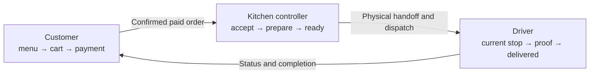

# Buffet Pin Direct Ordering Experience Vision

Status: **CONFIRMED PRODUCT SOURCE OF TRUTH**
Owner: Buffet Pin
Confirmed: 2026-08-13
Implementation status: **CODE COMPLETE — MANUAL/EXTERNAL VERIFICATION REQUIRED**

## Authority and purpose

This document defines the intended day-to-day Buffet Pin Direct ordering experience and the operational ownership model that the application must support. It is the product source of truth for the ordering-experience rework.

When this document conflicts with the current restaurant, customer, or driver interface, this document governs the rework. The launch safety rules, payment and provider invariants, audit requirements, authorization boundaries, and external verification gates in the other `docs/launch/` documents remain binding. The implementation may preserve additional internal states when they are required for correctness, but it must not expose implementation complexity as routine staff workflow.

Any material change to the actors, ownership handoff, visible lifecycle, acceptance policy, proof-of-delivery requirement, or primary screen responsibilities defined here requires an explicit owner decision recorded in `DECISIONS.md`.

## Product statement

Buffet Pin Direct has one simple operational loop:

1. A customer places and pays for a delivery order.
2. One kitchen controller is alarmed, reviews the order, and accepts or refuses it.
3. The kitchen controller owns the order while it is prepared and packed.
4. The application recommends the driver, batch, stop order, and safe departure timing.
5. The kitchen controller confirms the physical handoff and dispatches the run.
6. The driver owns the dispatched run, completes its stops in order, and records photo proof for each delivery.
7. The customer sees and receives clear status updates through completion.

There are three everyday product experiences:

- Customer ordering and status.
- One kitchen-controller console.
- One focused driver application.

Manager, reporting, reconciliation, configuration, and technical-recovery tools remain necessary, but they are supporting surfaces rather than part of the normal order loop.

## Experience principles

1. **One clear owner at a time.** The customer owns cart construction, the kitchen controller owns paid restaurant work until physical dispatch, and the driver owns the run after dispatch.
2. **The next action and its deadline are always obvious.** Staff should not interpret raw state names to know what to do.
3. **The normal path is simple; exceptions remain safe.** Provider, printer, payment, refund, notification, route, upload, and connectivity failures appear only when relevant, with a specific recovery action.
4. **Time drives the experience.** Acceptance, preparation, batching, departure, and delivery promises are active operational clocks rather than passive timestamps.
5. **The application recommends; the human confirms.** Driver, batch, stop-order, wait, and departure recommendations remain explainable and overridable within server-enforced safety constraints.
6. **Dispatch is a physical handoff.** An order does not leave the controller's ownership merely because a route was planned.
7. **Customer language describes real facts.** “On the way” means the food has actually been handed to the driver and dispatched.
8. **Routine simplicity does not collapse financial or operational truth.** Payment, refund, print, restaurant production, run, stop, notification, and proof facts remain independently auditable.

## Actors and responsibilities

### Customer

The customer:

- Views the available delivery menu.
- Selects items, modifiers, quantities, and instructions.
- Supplies delivery and contact information.
- Reviews pricing and a credible delivery expectation before paying.
- Completes payment through Clover without Buffet Pin receiving raw card data.
- Follows restaurant confirmation, preparation, dispatch, and delivery status.
- Receives material updates and the final delivery confirmation.

The customer does not participate in production, batching, driver assignment, or internal recovery decisions.

### Kitchen controller

One confirmed kitchen staff member is the restaurant-side operational owner. This person has access to the kitchen printer and a laptop or tablet and is responsible for:

- Receiving the paid-order alarm.
- Reviewing the complete order.
- Accepting or refusing the order.
- Confirming that the kitchen ticket is available or following print recovery.
- Placing the ticket on the kitchen line.
- Monitoring preparation against the ready-by clock.
- Adding preparation time when genuinely required.
- Physically packing the completed food.
- Marking the order ready for delivery.
- Reviewing the application's driver, batch, wait, stop-order, and departure recommendation.
- Confirming order numbers and the physical bag-to-driver handoff.
- Dispatching the run.
- Handling ordinary exceptions within a deliberately limited permission set.

The controller should not need unrestricted manager access to catalog configuration, staff administration, reporting, technical tools, arbitrary refunds, or provider reconciliation.

### Driver

The assigned driver:

- Receives an ordered run only after restaurant dispatch.
- Sees one current stop in focus and the remaining queue in order.
- Starts navigation for the current stop.
- Sees address, customer/drop-off instructions, elapsed time, and relevant ETA information.
- Marks arrival.
- Captures acceptable photo proof.
- Finalizes delivery only after proof is durably attached to the correct stop.
- Advances automatically to the next stop.
- Receives a return-to-restaurant prompt and directions after the final stop.
- Records a specific exception when delivery cannot be completed.

The driver cannot reorder stops, claim another driver's run, bypass required proof, or mark an order delivered before it is in a deliverable state unless an explicit, audited exception policy permits it.

## Ownership model

| Phase | Operational owner | Ownership begins | Ownership ends |
|---|---|---|---|
| Ordering | Customer | Customer starts the cart | Payment is submitted and the customer receives the order status experience |
| Restaurant fulfilment | Kitchen controller | Payment is authoritatively confirmed and the incoming order is raised | The controller confirms the physical handoff and dispatches the run |
| Delivery | Driver | The run is dispatched to the authenticated assigned driver | The final stop is completed or the run enters an explicit exception/return workflow |

Route planning or driver recommendation alone does not transfer ownership. “Ready for delivery” also does not transfer ownership. Only the controller's physical-handoff dispatch action transfers the order to the driver.

## Visible lifecycle

The three audiences do not need to see identical state names.

| Operational fact | Customer sees | Controller sees | Driver sees |
|---|---|---|---|
| Cart/payment incomplete | Checkout | Nothing | Nothing |
| Paid; restaurant decision required | Waiting for restaurant confirmation | **New — respond now** | Nothing |
| Accepted and kitchen working | Preparing | **Preparing** | Nothing or an optional non-actionable upcoming-work indication |
| Food complete and packed | Preparing | **Ready for delivery** | Nothing until dispatch |
| Bags physically handed to driver | On the way | **Handed to driver** and removed from active responsibility | **Current run / current stop** |
| Driver at destination; proof incomplete | On the way | Driver has order | **Proof required** |
| Proof accepted and stop finalized | Delivered | Delivered/history | **Next stop** or **Return to Buffet Pin** |
| Restaurant cannot fulfil | Unable to fulfil; refund status | Refused/refund status | Nothing |
| Delivery cannot complete | Delivery issue; support status as appropriate | Exception/recovery | Exception and next safe action |

### Internal facts that remain separate

The visible lifecycle is intentionally simpler than the backend. The implementation must continue to represent, protect, and audit at least:

- Provider payment state and payment reconciliation.
- Refund requirement and refund outcome.
- Initial print intent, physical print confidence, fallback, and reprint state.
- Restaurant acceptance decision and acceptance deadline.
- Preparation start and current ready estimate.
- Packed confirmation and physical ready location.
- Run planning, driver assignment, ordered stops, and physical dispatch.
- Per-stop pickup, en route, arrival, proof, completion, and exception facts.
- Notification intent, provider acceptance, delivery, failure, and unknown outcomes.

The front end may combine several of these facts into one action or label only when the server still records the real facts atomically or through a safe, recoverable workflow.

## Detailed experience

### 1. Customer ordering

The normal customer loop is:

`Menu → item configuration → cart → delivery details → checkout → payment → order status`

Requirements:

- The server remains authoritative for availability, delivery eligibility, price, tax, fee, tip, and total.
- Checkout shows a credible delivery window before payment.
- A local pending order may be created to coordinate Clover safely, but it must not become kitchen work until server-side payment confirmation.
- Successful browser redirection is not payment proof.
- The customer receives a private status link and immutable human-facing order number.
- The customer sees a concise explanation of what is currently happening and the latest honest delivery window.

### 2. Incoming-order alarm and decision

When payment becomes authoritatively confirmed:

- The system creates one durable incoming-order decision deadline.
- The controller console receives an immediate realtime invalidation and refetches the authorized order.
- A fullscreen, visually dominant alarm appears with a persistent, distinctive sound on enabled restaurant devices.
- The alarm shows the full order, modifiers, special instructions, order number, customer promise, acceptance countdown, and print health.
- The primary action is `Accept and start preparing`.
- The destructive alternative is `Refuse and refund`, with a required reason.
- Silencing the sound on one device does not acknowledge or cancel the server deadline.
- Browser audio restrictions, sleeping devices, realtime interruption, and closed tabs require a tested visual and secondary escalation path.

Acceptance policy:

- The initial maximum decision window is 12 minutes and must be configurable rather than hard-coded.
- The server deadline is authoritative; a browser countdown is only a projection.
- A normal acceptance records the actor and time, cancels the timeout action, and makes the visible state `Preparing`.
- Successful acceptance resets the consecutive missed-acceptance count.
- If the deadline wins the race, the order is stopped, enters the durable full-refund workflow, the customer is informed, and an immutable system event is recorded.
- Two consecutive missed acceptance deadlines automatically pause new public orders.
- Explicit staff refusal, customer cancellation, and payment failure do not count as missed acceptance. Refusal reasons such as closed or too busy may separately recommend or require a pause.
- During the pilot, an automatic pause requires an explicit human resume after operational readiness is checked. Existing paid orders and durable work are never discarded by the pause.

Normal-path interpretation:

- To the controller, acceptance is one action and the order becomes `Preparing`.
- Internally, merchant commitment and kitchen release may remain separate facts so a printer failure cannot be mistaken for a usable kitchen ticket.
- If the ticket is not safely available, the same alarm surface explains print recovery and keeps unpaid or unprinted work from being silently released.

### 3. Preparing and packing

`Preparing` is the only normal visible restaurant-production state after acceptance.

It includes:

- The paper ticket being placed on the line.
- Cooking and assembly.
- Packing the completed order.
- Verifying the order number, quantities, modifiers, instructions, and physical bag.

The controller view must show:

- Order number and order age.
- Ready-by countdown and customer delivery promise.
- Complete item/modifier/instruction detail.
- Print health only when relevant.
- Current driver/batch outlook when useful.
- `Add time` with bounded choices and a required reason where appropriate.
- `Ready for delivery` as the primary completion action.

Packing is a required physical fact, not a separate everyday screen or lane. The application may retain packing timestamps, checks, or internal status for audit and safety. The normal controller should not have to step through `Preparing → Packing → Packed → At dispatch desk`.

`Ready for delivery` means the controller confirms that:

- Kitchen work is complete.
- The food is packed.
- The bag and ticket carry the correct order number.
- Required modifiers and instructions were checked.
- The order is physically available for driver handoff.

### 4. Ready-for-delivery decision support

Once ready, the application should tell the controller what to do rather than require manual construction of routing objects.

Representative recommendations:

- `Send now with Daniel.`
- `Hold up to 4 minutes for BP-260813-0017.`
- `Add to Daniel's current restaurant pickup.`
- `No eligible driver is currently available.`
- `Dispatch within 3 minutes to protect the promise.`

The recommendation must account for:

- Paid and ready status.
- Driver identity, active shift, availability, and zone eligibility.
- Maximum four orders per run.
- Same-zone batching by default.
- Order age, food freshness, ready time, maximum wait, dispatch deadline, and customer promise.
- Route duration and stop order when the routing provider is available.
- Deterministic manual fallback when routing is unavailable.
- Existing driver work and safe return/pickup timing.

The controller can accept a recommendation or choose a safe alternative. Overrides that weaken a default constraint require a reason and audit evidence. The interface should use restaurant language, not provider terms, evidence-token terminology, or implementation state names.

### 5. Physical handoff and dispatch

The controller's dispatch action occurs only when the driver is present and the included bags are physically handed over.

The primary action is conceptually `Confirm bags and dispatch run`.

It must:

- Show the assigned driver and ordered list of order numbers.
- Require concise confirmation that every displayed bag is present and matches its order number.
- Revalidate payment, ready state, driver eligibility, run capacity, zone rules, and exclusive assignment on the server.
- Atomically or recoverably freeze the ordered run and record the physical handoff.
- Transfer operational ownership from controller to driver.
- Remove the orders from the controller's active workload while retaining history and exception visibility.
- Put the ordered run into the assigned driver's application.
- Change customer status to `On the way` and enqueue the corresponding notification.
- Write actor, driver, order numbers, run, time, and any override to immutable audit history.

Run planning, recommendation, or preselection must not tell the customer that the order is on the way. Only the physical-handoff dispatch action may do so.

### 6. Driver run and current-stop experience

The driver application is mobile-first and task-focused.

Before starting:

- Show the assigned run number, bag/order numbers, stop count, and ordered queue.
- Make the first actionable stop visually dominant.
- Allow `Start route` to focus the stop and open the preferred maps application.

For the current stop, show:

- Sequence position and order number.
- Customer name and permitted contact action.
- Complete delivery address.
- Drop-off instructions.
- Maps/directions action.
- Elapsed route/stop time and relevant ETA or promise risk.
- `Arrived` and `Delivery exception` actions.

The driver must not be presented with equivalent completion controls for every stop simultaneously. The server enforces the intended sequence or requires an audited dispatcher override.

After `Arrived`:

- The interface enters a proof step; arrival alone does not mean delivered.
- The driver captures or selects the delivery photo.
- The app shows a review of the selected image.
- The driver can retake it.
- `Finalize delivery` remains disabled until the proof upload is durably acknowledged and bound to the exact stop.

After finalization:

- The order becomes delivered exactly once.
- The customer status updates.
- SMS and email delivery notifications are durably enqueued.
- If another stop remains, it becomes the focused current stop.
- If no stop remains, the run completes and the driver sees `Return to Buffet Pin` with directions.

If delivery cannot be completed, the driver records a specific reason and follows the failed-delivery/return workflow rather than falsely marking the order delivered.

### 7. Customer status and notifications

The customer experience should emphasize five understandable outcomes:

1. Waiting for restaurant confirmation.
2. Preparing.
3. On the way.
4. Delivered.
5. Unable to fulfil/delivery issue, including the honest refund or support status.

Requirements:

- Before restaurant acceptance, show that payment is confirmed and the restaurant has a bounded confirmation deadline.
- After acceptance, show the current ready and delivery expectation without exposing internal kitchen states.
- A material delay updates the current estimate and triggers an appropriate notification.
- `On the way` begins only at physical dispatch.
- `Delivered` begins only after the driver's required proof is durably recorded and completion succeeds.
- SMS and email are independent durable notification intents; one transport failure must not roll back delivery truth.
- Notification failure is visible to staff and recoverable without resubmitting an ambiguous provider request blindly.
- The customer is not promised a refund until the provider outcome is confirmed.

Whether the customer may view the proof photo is a separate privacy/product decision. The photo is private operational evidence by default.

## Primary interfaces

### Customer storefront and status

One cohesive customer experience covers menu, cart, checkout, payment result, and live order status. Internal restaurant and provider concepts remain hidden.

### Kitchen Controller console

The normal controller should not navigate among separate Orders, Production, Packing, Dispatch, and Needs Attention applications. One console presents four working lanes:

1. **New — respond now**
2. **Preparing**
3. **Ready for delivery**
4. **Handed to driver**

Exceptions appear inline on the affected order with the next safe action. Rare manager or technical recovery may deep-link to a supporting surface.

The console is optimized for a shared kitchen laptop/tablet, large touch targets, loud-environment legibility, realtime updates, and recovery after refresh or temporary disconnection.

### Driver application

The driver application presents one run, one current stop, and one primary action at a time. Remaining stops are visible as an ordered queue but cannot distract from or bypass the current stop.

## Current system relative to the vision

### Foundations to preserve

The current repository already provides valuable foundations:

- Customer menu, cart, Clover checkout, and private status link.
- Server-authoritative pricing and delivery eligibility.
- Non-downgrading paid-state reconciliation.
- Unique initial kitchen print intent and explicit print recovery.
- Immutable operational order number and audit events.
- Separate payment, refund, production, and dispatch facts.
- Paid cancellation/refusal refund coordination.
- One-to-four-order delivery runs.
- Same-zone defaults, driver shifts, and zone eligibility.
- Deadline-aware batching rules and replaceable routing provider.
- Ordered delivery stops and driver-scoped access.
- Customer realtime status and SMS notifications.
- Online-order kill switch, busy mode, capacity controls, alerts, and reconciliation.

These systems should be reused and simplified at the presentation/orchestration layer rather than replaced wholesale.

### Experience gaps to close

| Vision requirement | Current system | Rework implication |
|---|---|---|
| Fullscreen paid-order alarm with sound and countdown | Orders can update in realtime, but no authoritative acceptance alarm experience exists | Add durable acceptance deadline, alarm orchestration, audio/visual escalation, and recovery |
| One controller owns acceptance through dispatch | Routine work is split across Orders, Production, Dispatch, and attention screens | Replace routine fragmentation with one controller console |
| Controller can accept or refuse safely | Operator can produce/print but cannot dispatch or invoke the full-refund refusal workflow | Add a least-privilege controller capability bundle |
| Accepted visibly becomes Preparing | Acceptance is a separate production step and is blocked by print confirmation | Provide one normal action while retaining internal print/commitment safety |
| Packing is not a visible stage | Packing, per-item verification, packed, and dispatch-desk placement are separate UI transitions | Collapse into Preparing plus one Ready-for-delivery confirmation |
| System recommends driver, batch, and wait | Current dispatch UI asks staff to select a driver before showing suggestions | Make recommendations proactive and restaurant-readable |
| Dispatch is physical ownership transfer | Run approval, bag checks, pickup, and en-route changes are separate actions across staff and driver | Create one deliberate physical-handoff dispatch workflow |
| Driver sees one focused stop | Current run view exposes actions for all stops together | Introduce enforced current-stop sequencing and focused mobile UX |
| Directions, elapsed time, arrival, proof, next/return | Current run UI lacks these experiences | Build the focused route and completion flow |
| Photo proof required before delivery | No proof artifact or upload flow exists | Add private storage, authenticated upload, stop binding, retention, access, and failure recovery |
| Delivered SMS and email | Delivered SMS exists; order email delivery does not | Add an email provider path with independent durable status |
| Auto-pause after missed orders | Global ordering boolean exists without missed-acceptance policy or pause reason | Add reasoned pause state, streak, audit, and manual resume |

## Authorization model for the controller

The kitchen controller needs the minimum capabilities required for the complete restaurant-side loop:

- Read operational orders.
- Accept a paid incoming order.
- Refuse a new order through the automatic full-refund workflow.
- Confirm or recover kitchen printing.
- Update preparation time.
- Mark an order ready for delivery.
- Review and approve safe driver/run recommendations.
- Confirm bags and dispatch a run.
- View and act on ordinary order exceptions.

This role does not inherently receive:

- Catalog or pricing administration.
- Staff-account administration.
- Business settings changes.
- Reporting or reconciliation access.
- Arbitrary or partial refund authority.
- Technical/development tools.

Every privileged mutation remains server-authorized and actor-audited. A shared physical device does not justify an anonymous shared identity unless the owner explicitly accepts the accountability tradeoff.

## Proof-of-delivery requirements

Photo proof is part of the confirmed target experience. Implementation requires an approved privacy and retention policy before production use.

Minimum product rules:

- Proof belongs to one immutable delivery stop and order.
- Upload uses an authenticated, short-lived mechanism; application servers do not expose broad storage credentials.
- Proof is private by default and excluded from public order projections.
- Drivers are instructed not to photograph people, faces, payment information, or the interior of a home.
- The app supports review and retake before finalization.
- A delivery cannot finalize until the required upload is durably confirmed.
- Duplicate finalization does not create duplicate proof or duplicate customer messages.
- Failed or ambiguous upload remains visible and recoverable.
- Access and deletion are audited where supported.
- Retention duration, authorized viewers, customer visibility, legal basis, and exceptional no-photo completion require explicit owner/privacy approval.

## Exception boundary

The happy path defined here is the complete routine ordering experience, but the application must also preserve safe handling for:

- Payment pending, declined, failed, duplicated, or ambiguous.
- Clover order creation mismatch or ambiguity.
- Kitchen print missing, failed, duplicated, or unknown.
- Acceptance deadline expiration and automatic ordering pause.
- Staff refusal and full-refund success, failure, or unknown outcome.
- Item unavailable after payment.
- Preparation delay.
- No eligible driver.
- Routing failure or implausible route.
- Driver/device offline.
- Customer unreachable or unsafe/inaccessible drop-off.
- Failed delivery and physical return.
- Proof permission, capture, upload, or persistence failure.
- SMS or email notification failure.
- Late order, customer complaint, or reconciliation variance.

These exceptions should not add routine steps. They appear on the affected order with a plain-language explanation, consequence, owner, and next safe action.

## Scope boundaries

### In scope for the rework

- Delivery-only, ASAP customer ordering.
- Customer delivery estimate and live status experience.
- Paid-order alarm, timed acceptance/refusal, refund, and missed-order pause.
- One kitchen-controller console from acceptance through dispatch.
- Simplified visible `Preparing` and `Ready for delivery` production flow.
- Proactive driver/batch/departure recommendations.
- Physical handoff and dispatch ownership transfer.
- Driver current-stop queue, directions handoff, timing, arrival, photo proof, next stop, and return prompt.
- Delivered SMS and email.
- Inline operational exceptions and links to rare recovery tools.
- Least-privilege controller authorization and immutable audit evidence.

### Out of scope unless separately approved

- Customer pickup.
- Scheduled orders.
- Marketplace couriers or external fleet marketplaces.
- Live driver GPS shown to customers.
- Built-in turn-by-turn navigation when a safe maps-app handoff is sufficient.
- Automatic/AI dispatch without controller approval.
- More than four orders per run.
- Cross-zone batching without an explicit audited override.
- Multiple kitchen stations or printer routing by station.
- Customer order editing after payment.
- Customer-visible proof photos by default.

## Rework acceptance criteria

The ordering-experience rework is not complete until all applicable existing launch criteria and the following experience criteria are satisfied:

1. A paid fake/test order raises one prominent controller alarm with an authoritative countdown and no duplicate alarm side effect.
2. Normal acceptance is one controller action and produces the visible `Preparing` state while preserving payment and print gates.
3. Refusal and acceptance-timeout paths stop work, create one durable refund intent, inform the customer honestly, and remain recoverable if the provider outcome is unknown.
4. Two consecutive missed acceptance deadlines pause new intake without losing existing paid work; authorized manual resume is audited.
5. The controller can complete the normal restaurant path without navigating to separate production, packing, dispatch, or attention applications.
6. Packing is not a normal visible lane, but `Ready for delivery` records sufficient physical-completion and order-number evidence.
7. Ready orders receive an explainable driver/batch/wait/departure recommendation that respects capacity, zone, shift, deadline, and route constraints.
8. Dispatch requires physical bag/driver confirmation, transfers ownership once, freezes the ordered run, updates every included customer, and survives duplicate submission safely.
9. The assigned driver receives only authorized runs and cannot complete stops out of sequence without an audited exception.
10. The driver can start directions, mark arrival, capture/review/retry proof, and cannot finalize until proof is durably bound to the stop.
11. Finalization updates delivery truth once, advances to the next stop or return prompt, and independently enqueues SMS and email.
12. Customer wording and timestamps remain consistent with authoritative restaurant and driver actions.
13. Realtime, audio, provider, route, upload, and notification failures have visible fallbacks and recovery paths.
14. The complete customer → controller → driver → delivered flow works on representative customer, kitchen tablet/laptop, and driver phone devices.
15. Automated tests cover state transitions, concurrency, authorization, deadlines, pause/reset policy, run sequencing, proof upload/finalization, and notification idempotency.
16. On-site rehearsal proves the alarm is noticeable, the ticket/bag/order number stays consistent, the controller can operate the complete console, and drivers can complete one-, two-, and four-stop runs.

## Rework sequence

This is dependency order, not authorization to implement every item at once:

1. Stabilize product terminology, controller permissions, and visible projections.
2. Add durable acceptance deadline, alarm, refusal/timeout refund, missed-order pause, and manual resume.
3. Build the consolidated Kitchen Controller console and collapse visible packing steps.
4. Turn existing batching/routing machinery into proactive driver, wait, and departure recommendations.
5. Implement physical-handoff dispatch as the ownership-transfer transaction.
6. Rebuild the driver experience around an enforced current stop, maps handoff, arrival, and next/return behavior.
7. Add private photo proof and finalize-delivery coordination after privacy/storage policy approval.
8. Add durable order-email delivery and align all customer wording/windows.
9. Exercise failure injection, responsive/accessibility checks, staff/driver rehearsals, and the controlled production evidence gates.

Each implementation slice requires its own execution plan, tests, documentation/status update, and explicit remaining manual gates. Production ordering remains disabled until the existing launch go-live requirements are satisfied.

## Decisions still requiring owner or professional approval

The following do not reopen the confirmed product vision, but they must be resolved before corresponding production behavior is enabled:

- Exact controller identity/shared-device policy.
- Initial acceptance escalation channels beyond the in-app alarm.
- Preparation-delay choices and maximum controller extension.
- Pilot batching thresholds and when a driver may be shown upcoming work.
- Preferred maps application behavior on supported driver devices.
- Photo retention duration, authorized viewers, customer access, exceptional no-photo completion, and privacy/legal basis.
- Failed-delivery/customer-unreachable procedure and physical return policy.
- Email provider, sender identity, consent/compliance language, and delivery monitoring.
- Final customer promise wording and support/escalation ownership.

## Definition of success

The reworked application succeeds when a new controller or driver can perform the normal job correctly without learning Buffet Pin's database states or navigating among implementation subsystems, while every paid order, print, acceptance decision, refund, physical handoff, route, proof, delivery, and notification remains visible, attributable, and recoverable underneath.
